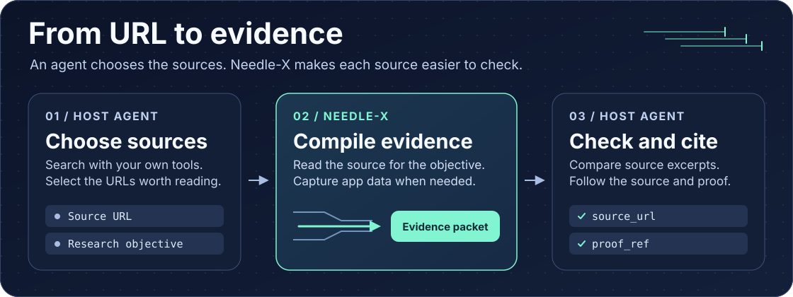
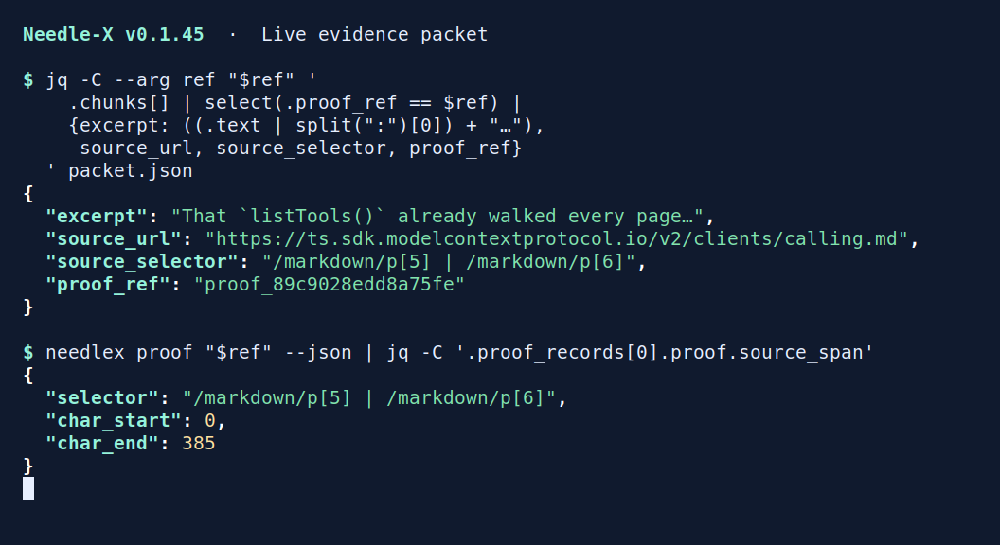

# Needle-X

[](https://github.com/Josepavese/needlex/releases/latest)
[](https://github.com/Josepavese/needlex/actions/workflows/dist.yml)
[](https://github.com/Josepavese/needlex/actions/workflows/installer-smoke.yml)

**Needle-X is the evidence layer in an agent’s web research workflow.** Give it a URL and a research objective. It returns a compact packet of relevant excerpts, source locations and proof references that the agent can inspect before citing.

The agent owns search, source selection and synthesis. Needle-X runs locally and does the reading through an MCP server or a CLI.



> [!NOTE]
> **Alpha.** CLI, MCP and output contracts are evolving. Pin a release for integrations that depend on a specific schema.

## Start with one URL

Already [installed](#install)? Read a source with a concrete question.

```bash
needlex read https://ts.sdk.modelcontextprotocol.io/v2/clients/calling \
  --objective "How does an MCP client discover and invoke tools?" \
  --json > packet.json
```



*Captured from a live read with v0.1.45. The terminal shows one shortened excerpt and its source and proof fields. For this page, Needle-X used the source’s published Markdown representation.* [Full-size capture](docs/assets/cli-evidence.png) · [Source page](https://ts.sdk.modelcontextprotocol.io/v2/clients/calling)

## Use it from an agent

Configure a local stdio MCP server with command `needlex` and argument `mcp`. In Codex:

```bash
codex mcp add needlex -- needlex mcp
```

For open-web research, use the host agent’s search tool to find URLs. Give `web_read` each URL you choose to analyze and reuse the same objective across sources you plan to compare. The host agent decides how many URLs to inspect.

| Task | MCP | CLI |
| --- | --- | --- |
| Read one selected URL and extract evidence for an objective | `web_read` | `needlex read` |
| Find the relevant page within a site from a verified seed URL | `web_query` | `needlex query` |
| Explore links from a seed within a page and depth budget | `web_crawl` | `needlex crawl` |
| Inspect the proof record behind an excerpt | `web_proof` | `needlex proof` |
| Save original HTTP response bytes | `web_fetch` | `needlex fetch` |

[Tool schemas and examples](docs/wiki/MCP-And-Tool-Calling.md) · [CLI reference](docs/wiki/CLI.md) · [Optional Codex skill](skills/needlex-web-retrieval/SKILL.md)

## Read the packet

- **Evidence.** Read `chunks` alongside the summary. Each chunk can carry a `source_url`, `source_selector` and `proof_ref`. Pass the proof reference to `web_proof` or `needlex proof` to inspect the source span and its recorded transformations.
- **Coverage.** Use `uncertainty` and `signals` to decide whether the excerpts cover the question. Needle-X can render pages when needed and include textual payloads from fetch/XHR, SSE and WebSockets within a capture budget. `content_source` distinguishes rendered DOM from DOM plus captured network data. Check `network_truncated` and `render_degraded` before drawing conclusions from missing content.
- **Audit.** Use `trace_id` to inspect the recorded run. The compact packet is the default. Full JSON, replay and diff are available when you need more detail.

Needle-X uses multilingual dense embeddings to align page content with the objective. The runtime stores proofs, traces and reusable retrieval state locally. [Packet contract](docs/agent-answer-packet.md) · [Discovery memory](docs/wiki/Discovery-Memory.md)

## Get the original bytes

Use `web_fetch` or `needlex fetch` when the task needs the original HTML or a binary file. With `--assets`, the CLI also saves directly linked stylesheets and scripts from the page’s origin. Use `--asset-origin` to include a trusted CDN. The MCP equivalents are `assets` and `asset_origins`.

```bash
needlex fetch https://example.com/ --assets --out-dir ./page-source
```

Both interfaces return file paths and HTTP metadata. [Raw download reference](docs/wiki/CLI.md#raw-downloads)

## Install

Install the user-local binary on Linux or macOS:

```bash
curl -fsSL https://raw.githubusercontent.com/Josepavese/needlex/main/install/install.sh | bash
```

On Windows:

```powershell
irm https://raw.githubusercontent.com/Josepavese/needlex/main/install/install.ps1 | iex
```

The installer sets up the local embedding runtime and headless browser. Run `needlex doctor` to check readiness. [Installation and configuration](docs/wiki/Install.md)

## Evaluation

The October 2026 installed-MCP baseline on v0.1.43 returned nonempty packets with mapped proofs for **818 of 1,000 selected public URLs**. Of those, **762** had complete capture by the run’s diagnostics. A separate 60-question panel measured retention of source markers. The report records the sample, failures and limits of each measurement. [Public-web assessment](docs/popular-web-assessment.md) · [Benchmark protocols and reproduction](benchmarks/README.md)
